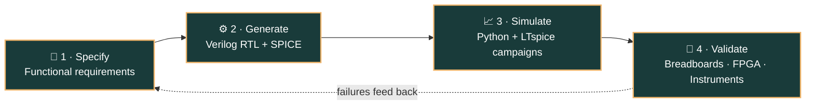

<!-- ================= HEADER ================= -->

<h3 align="center">⚡ Digital Design & Verification × 🔌 Embedded Systems × 🛠️ PCB Design & Bring-Up × 🤖 AI-Assisted EDA</h3>

<em>I build and validate computing systems across the hardware stack — from <strong>Verilog RTL and SPICE models</strong> to <strong>custom PCBs, embedded firmware, FPGA prototypes, and physical measurements</strong>.</em>

  
  
  

<!-- ================= ABOUT ================= -->
<h2 align="center">🎓 About Me</h2>

<table align="center" width="100%">
  <tr>
    <th align="center">🎓 Education</th>
    <th align="center">⚡ Engineering Focus</th>
    <th align="center">🔎 Currently Seeking</th>
  </tr>
  <tr>
    <td align="center" valign="top"><strong>University of Southern California</strong> B.S. Electrical &amp; Computer Engineering Expected May 2028 · GPA <strong>3.8 / 4.0</strong></td>
    <td align="center" valign="top">Digital Hardware · FPGA / RTL Hardware Verification Embedded Systems · PCB Design HW/SW Integration</td>
    <td align="center" valign="top"><strong>Summer 2027</strong> roles in digital hardware, FPGA/RTL, hardware verification, firmware &amp; embedded systems</td>
  </tr>
</table>

<em>💭 I want to rethink computing systems to engineer a better world. I'm especially passionate about embedded systems, PCB design, soldering, and the collaborative engineering community that turns ideas into working hardware.</em>

  <strong>Relevant coursework</strong> 
  <code>Digital Circuits</code> · <code>Embedded Systems</code> · <code>Linear Circuits</code> · <code>Distributed Systems &amp; IoT</code> 
  <code>Probability &amp; Random Processes</code> · <code>Computer Networks</code> · <code>Data Structures &amp; Algorithms</code> · <code>Machine Learning</code>

<!-- ================= RESEARCH ================= -->
<h2 align="center">🔬 Research Spotlight</h2>
<h3 align="center">AI-Assisted Hardware Design &amp; Physical Verification</h3>

  At <strong>USC's Kapadia Lab</strong>, I develop Python-based EDA workflows that turn functional specifications into 
  executable <strong>Verilog RTL</strong> and <strong>SPICE netlists</strong>, then test whether generated designs actually work beyond syntax and simulation.

<table align="center" width="100%">
  <tr>
    <td width="25%" align="center"><h3>🧪 105+</h3>circuit categories validated</td>
    <td width="25%" align="center"><h3>📟 Oscilloscope</h3>comparison against hand-built circuits</td>
    <td width="25%" align="center"><h3>🔁 FPGA</h3>verification workflow</td>
    <td width="25%" align="center"><h3>📄 Publication</h3>empirical results toward a peer-reviewed paper with Ph.D. researchers</td>
  </tr>
</table>

<!-- ================= TECH ================= -->
<h2 align="center">🛠️ Tech Arsenal</h2>

<h3 align="center">💻 Languages &amp; Hardware Description</h3>

  
  
  
  
  
  
  

<h3 align="center">🔌 Hardware, EDA &amp; Embedded</h3>

  
  
  
  
  
  
  
  

<h3 align="center">🧰 Systems, Tools &amp; AI</h3>

  
  
  
  
  
  
  
  
  

<b>📋 Full skill breakdown (click to expand)</b>

 

<table align="center" width="100%">
  <tr>
    <td width="50%" align="center" valign="top"><strong>Digital Design &amp; Verification</strong> Verilog · RTL · FPGA · FSMs · synchronous logic · testbenches · directed testing · waveform debugging · VGA · Vivado · QuestaSim</td>
    <td width="50%" align="center" valign="top"><strong>Embedded Systems</strong> ESP32 · AVR · embedded firmware · timers · interrupts · PWM · EEPROM · I2S audio · sensor interfaces · MQTT</td>
  </tr>
  <tr>
    <td align="center" valign="top"><strong>PCB, Circuits &amp; Power</strong> KiCad · SPICE · LTspice · schematic capture · multilayer layout · analog filtering · signal conditioning · DC-DC regulation · LiPo charging/protection · CAD modeling</td>
    <td align="center" valign="top"><strong>Lab &amp; Bring-Up</strong> PCB bring-up · SMD/through-hole soldering · breadboarding · oscilloscopes · logic analyzers · multimeters · fault isolation · test automation · cleanroom safety</td>
  </tr>
  <tr>
    <td align="center" valign="top"><strong>Programming &amp; Systems</strong> C++ · Python · MATLAB · JavaScript · HTML · React · Linux/Unix · Git · JIRA · FTP · Docker · Kubernetes · Grafana · Telegraf · InfluxDB</td>
    <td align="center" valign="top"><strong>AI, Data &amp; Optimization</strong> PyTorch · NumPy · Pandas · CNNs/RNNs · quantization · numerical analysis · LLM pipelines · RAG · prompt engineering · Particle Swarm Optimization</td>
  </tr>
</table>

<!-- ================= PROJECTS ================= -->
<h2 align="center">🚀 Selected Hardware Projects</h2>

<table align="center" width="100%">
  <tr>
    <td width="50%" align="center" valign="top">
      <h3><a href="https://github.com/uscmakers/SunshineSleepMask">🌅 Sunshine Sleep Mask</a></h3>
      <code>ESP32</code> <code>KiCad</code> <code>C++</code> <code>I2S</code> <code>LiPo</code> <code>APA102</code>
      
A wearable embedded system combining adaptive illumination, audio feedback, real-time sensing, and ML-informed behavior from physiological sleep data.

      
Custom multilayer PCB around an <b>ESP32-WROOM-32</b> with LiPo charging/protection, DC-DC regulation, a MAX98357A audio amp, and APA102 LEDs. Validated through soldering, bring-up, bench measurements, and a companion React interface.

    </td>
    <td width="50%" align="center" valign="top">
      <h3><a href="projects/flappy-bird-fpga.md">🎮 Flappy Bird FPGA</a></h3>
      <code>Verilog</code> <code>RTL</code> <code>FSMs</code> <code>VGA</code> <code>QuestaSim</code>
      
A real-time FPGA game in modular Verilog RTL: FSM control, VGA rendering, player movement, obstacle generation, collision detection, and scoring.

      
Synchronous counters, clock dividers, and debounced inputs, verified with directed testbenches and waveform analysis (resets, state transitions, collision boundaries, timing) before deployment.

    </td>
  </tr>
  <tr>
    <td width="50%" align="center" valign="top">
      <h3><a href="projects/electric-guitar-pcb.md">🎸 Custom Electric Guitar PCB</a></h3>
      <code>LM324</code> <code>Analog</code> <code>PCB</code> <code>SMD</code>
      
A custom analog effects circuit with LM324 amplification, active filtering, signal conditioning, and interactive LEDs, built inside a guitar-shaped system.

      
Schematic → working hardware via PCB assembly, through-hole + SMD soldering, measurement, fault isolation, and iterative debugging.

    </td>
    <td width="50%" align="center" valign="top">
      <h3><a href="projects/avr-temperature-controller.md">🌡️ AVR Temperature Controller</a></h3>
      <code>AVR</code> <code>FSMs</code> <code>PWM</code> <code>Interrupts</code> <code>EEPROM</code>
      
Real-time control firmware using FSMs, timers, interrupts, and PWM, integrating temperature sensing, EEPROM storage, LCD output, rotary-encoder input, and configurable thresholds.

      
Timing, PWM, and hardware behavior validated with oscilloscope and multimeter measurements.

    </td>
  </tr>
  <tr>
    <td colspan="2" align="center" valign="top">
      <h3><a href="https://github.com/ariasgua/Cry_babies_monitor">👶 Baby Cry Monitoring System</a></h3>
      <code>Raspberry Pi</code> <code>Python</code> <code>MQTT</code> <code>NumPy</code> <code>SciPy</code> <code>FFT</code>
      
Multi-node IoT monitor with an FFT pipeline across the <b>300–3000 Hz</b> voice band and a <b>0.70 detection threshold</b>, distinguishing infant cries from ambient noise and pure-tone beeps.

    </td>
  </tr>
</table>

<!-- ================= FOCUS ================= -->
<h2 align="center">🔥 Current Focus</h2>

<table align="center" width="100%">
  <tr>
    <th width="50%" align="center">🔨 Building Now</th>
    <th width="50%" align="center">🎯 Goals</th>
  </tr>
  <tr>
    <td align="center" valign="top">FPGA hardware-in-the-loop validation of AI-generated RTL Sunshine Sleep Mask PCB bring-up &amp; firmware Flappy Bird on FPGA (Nexys A7)</td>
    <td align="center" valign="top">Land a <strong>Summer 2027</strong> hardware / FPGA / verification internship Publish empirical results in a peer-reviewed paper Grow USC's e-waste &amp; device-reuse program through Makers Club</td>
  </tr>
</table>

<!-- ================= EXPERIENCE ================= -->
<h2 align="center">💼 Experience at a Glance</h2>

<table align="center" width="100%">
  <thead>
    <tr>
      <th align="center">Organization</th>
      <th align="center">Role</th>
      <th align="center">Selected Engineering Impact</th>
    </tr>
  </thead>
  <tbody>
    <tr>
      <td align="center"><strong>Kapadia Lab</strong> · USC Viterbi Los Angeles, CA · Sep 2025–Present</td>
      <td align="center">Research Assistant</td>
      <td align="center">Develop Python EDA workflows with Ph.D. researchers for scalable hardware-design agents; diagnose RTL and circuit failures; contribute results toward a peer-reviewed publication.</td>
    </tr>
    <tr>
      <td align="center"><strong>M/Y Sindbad</strong> · 80 ft Motor Yacht San Juan, PR · May–Aug 2026</td>
      <td align="center">Marine Systems Engineering Technician</td>
      <td align="center">Diagnosed electrical, HVAC, refrigeration, hydraulic, and electromechanical failures on a 1962 Norwegian yacht via systematic fault isolation; coordinated OEM repairs; built the first onboard engineering documentation and asset-management system.</td>
    </tr>
    <tr>
      <td align="center"><strong>Siemens</strong> Panama City, Panama · May–Jun 2025</td>
      <td align="center">Project Engineering Intern</td>
      <td align="center">Led <strong>Cerberus PRO</strong> bring-up with Linux/Python and FTP firmware transfers; managed U-Boot/Linux kernel deployment across hospitals, an international airport, and metro infrastructure; authored <strong>15+ technical documents</strong>.</td>
    </tr>
    <tr>
      <td align="center"><strong>Soluciones Seguras, S.A.</strong> · Check Point Certified Panama City, Panama · Jun–Aug 2025</td>
      <td align="center">SOC Analyst Intern</td>
      <td align="center">Deployed Wazuh agents across Linux and Windows for centralized monitoring with a <strong>5+ member SOC team</strong> across Central America.</td>
    </tr>
    <tr>
      <td align="center"><strong>Super Computing In Pocket</strong> · USC Viterbi Los Angeles, CA · Sep 2024–May 2025</td>
      <td align="center">Research Assistant</td>
      <td align="center">Benchmarked hardware-aware LLM quantization on constrained GPUs, measuring compute, memory, latency, and accuracy tradeoffs.</td>
    </tr>
    <tr>
      <td align="center"><strong>USC Information Technology Services</strong> Los Angeles, CA · Jan 2025–Present</td>
      <td align="center">Lab Technician</td>
      <td align="center">Support faculty, staff, and students across <strong>120+ classrooms</strong>, 20 hrs/week.</td>
    </tr>
    <tr>
      <td align="center"><strong>Pass Solar S.A.</strong> Panama City, Panama · Jul–Aug 2023</td>
      <td align="center">Summer Engineering Intern</td>
      <td align="center">Designed and evaluated isolated, grid-connected, and solar-pumping PV systems for government and private infrastructure.</td>
    </tr>
  </tbody>
</table>

<!-- ================= LEADERSHIP ================= -->
<h2 align="center">🌍 Leadership &amp; Community Impact</h2>

<table align="center" width="100%">
  <tr>
    <td width="50%" align="center" valign="top">
      <h3>♻️ Makers Club · Sustainability Lead</h3>
      Aug 2026–Present
      
Lead USC's e-waste and device-reuse efforts: coordinating electronics collection, repair, and redistribution, and building partnerships across the university's sustainability community.

    </td>
    <td width="50%" align="center" valign="top">
      <h3>☀️ SET Club · President &amp; Founder</h3>
      Aug 2022–Aug 2024
      
Led solar-panel installations across <strong>20+ low-income communities</strong> without grid access, developed solar-inverter optimization code, and coordinated large-scale electronics and supply donations.

    </td>
  </tr>
</table>

<!-- ================= ANALYTICS ================= -->
<h2 align="center">📊 GitHub Analytics</h2>

<!-- ================= FOOTER ================= -->

<h2 align="center">🔧 Let's Build Reliable Hardware</h2>

I'm seeking <strong>Summer 2027</strong> opportunities in digital hardware, FPGA/RTL, hardware verification, firmware, embedded systems, and the hardware-software boundary.

  
  

<b>Design · Simulate · Build · Measure · Debug · Iterate</b>

